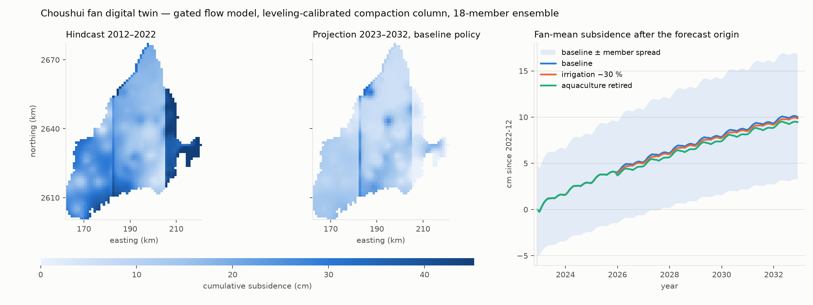

# HydroPhysicsAI

**A differentiable research twin of the Choushui alluvial fan, Taiwan: simulate how pumping affects groundwater heads and land subsidence, and test those simulations against observations.**

[](https://github.com/Rekin226/HydroPhysicsAI/actions/workflows/ci.yml)
[](https://www.python.org/)
[](#how-it-works)
[](LICENSE)

[Project state](docs/superpowers/STATE.md) · [Evidence update, Oct 2026](docs/TWIN_EVIDENCE_2026-10.md) · [Data](docs/DATA_FORMAT.md) · [Technical writeup](docs/TECHNICAL_WRITEUP.md) · [Model card](MODEL_CARD.md) · [Validation](docs/TWIN_RELEASE.md) · [Updates](docs/TWIN_ASSIMILATION.md) · [Papers](docs/papers/README.md) · [Earlier phase](docs/EARLIER_PHASE.md)

**Current status (October 2026):** see [the October evidence update](docs/TWIN_EVIDENCE_2026-10.md): the corrected observation update leaves the subsidence numbers unchanged, the page's run-spread band covered 75 % of 2023-26 observations at a nominal 90 %, a prospective head test is registered for November 2026 to October 2027, the first out-of-sample subsidence test (2023-25 rings and GNSS) is recorded, and the policy-timing mechanism is contradicted by the ring record and left unresolved. A statistical layer (climatology plus the decayed last-observed anomaly) beats climatology by 10 % over 2023-26 and 21 % in the first year where the physics alone does not, and is registered prospectively beside the physics for the same window; the physics' value for the heads is the scenario difference, not the level. The deep benchmarks printed in the WRA monthly reports, transcribed with the Claude API and verified, extend the subsidence evidence to January 2026: on the three piles anchored below 200 m the frozen column's two-year compaction is within 0.8 cm of the agency's numbers (RMSE 0.5 cm against 1.3 cm for continuing the previous year), while the 70 m pile is over-predicted because the column is total depth. These pile scores are report-only since 2026-10-21 (ruling U7): they were used to choose between columns, so they are not independent skill. The calibration rainfall turned out to be zero-filled where a gauge had closed; the 26 gauges were rebuilt from the CWA archive to October 2026 and the deliverable recalibrated on them, which left every score within noise of the registered model (section 11), so the page keeps the registered model. Registered policy-response tests (section 13, masked 2016-18 refits on a design-time window) support the head response to a pumping change in Yunlin, scored on a masked refit of the R0 recipe (`stage3_datum_gate_m1618`; R0 = `stage3_datum_gate_cwa`, the page model's recipe recalibrated on the rebuilt CWA rainfall), and in Changhua only on the census model R1c. The page displays `stage3_datum_gate` (`datum_gate_innov`), which carries no Changhua pumping; section 11 found it within noise of R0 on every earlier test, and a post-hoc, model-only comparison (not a test) puts their policy responses within 2-4 % of each other fan-wide. The R0 recipe scored on Changhua heads (a declared secondary) is marginal. In Yunlin the modelled head response is smaller than observed. The 1-3-year size of the subsidence response is not supported (two tests disagree in direction). Changhua class-specific and subsidence levers are withdrawn under every outcome, and the Changhua head lever is untested (N2C registered, scored not before 2028-01-15). In this model the avoided subsidence is an elastic response that arrives within about a year; its 1-3-year size is not supported by the registered tests, and whether a cut changes long-run sinking is untested. The round-5 build of the decision page (`results/twin/twin_app_20261029e.html`) carries these labels; the promoted `results/twin/twin_app.html` (the 2026-10-29 build `twin_app_20261029d`) predates them until the round-5 build is promoted. Since 2026-10-29 (user ruling) the page is scoped by a claims ledger (`hydrophysics/twin/claims_v1.json`, checked by `tests/test_twin_claims.py`): its answer is the Yunlin head response; the avoided-subsidence, area and rail numbers and the fan-wide baseline total are withdrawn to a labelled "model internals" section, because their size is not supported (rebuilt page `results/twin/twin_app_20261029c.html`, not yet promoted). The page model is `datum_gate_innov` (theta `stage3_datum_gate`), N2's registered primary model; R0 (`stage3_datum_gate_cwa`) and Q0 are ladder baselines, and the N1 verdicts reach the page model only through a post-hoc, model-only comparison. Inferring the missing quantities from the data already held did not close the open claims (section 14). An identifiability audit shows the calibration data do not pin the size of the head response or the Changhua aquifer properties. A storage-capped column failed its synthetic recovery check. Adding the measured public-supply abstraction improved Changhua head timing but failed the leveling and plausibility gates. The Yunlin head response is now decided prospectively by `N2.policy_response.prospective_2026-11.v1`, registered before its November 2026 to October 2027 window. The subsidence size needs new data (section 14 lists the requests); the Changhua head lever is untested (N2C registered, scored not before 2028-01-15), and the class-specific and subsidence Changhua levers are withdrawn under every outcome (section 17). The September status follows.

**Status in September 2026:** the frozen forecast fails the newer groundwater
challenge. An observation-update defect is corrected in an opt-in method, but the
physical forecasts still lose to simple short-term baselines. Policy and subsidence
projections remain research scenarios. See the [latest experiment findings](docs/TWIN_ASSIMILATION.md)
and [validation workflow](docs/TWIN_RELEASE.md).



---

## Overview

The Choushui fan is Taiwan's largest groundwater basin and its most serious subsidence
problem: unmetered irrigation pumping from four stacked aquifers, and a ground surface
sinking centimetres a year under the high-speed-rail corridor.

This repository is a physics-based twin of that system. A four-layer groundwater solver
on a 1 km grid is driven by the registered-pump electricity census and rain-minus-ET
recharge, coupled to a visco-elasto-plastic compaction column, and calibrated by gradient
descent through the solver's own adjoint. It takes a pumping policy, runs the aquifer
forward with a parameter ensemble, and reports the head response to the pumping change, which is
tested in Yunlin. Subsidence is shown only as the model's elastic rebound, labelled model internals:
its size under a policy is untested.

```
pumping policy ──▶ flow solver ──▶ layer heads ──▶ compaction column ──▶ subsidence ──▶ decision page
```

## Results

### New observations and update experiments

| Evaluation | Result |
|---|---|
| Frozen forecast, January 2023–August 2026; 158 wells | Datum-adjusted head RMSE **2.05 m** vs **1.67 m** for seasonal climatology (ratio 1.23, innovation update; 2.07 m under the superseded field update): **FAIL** |
| Forcing attribution, January 2023–June 2025; 156 wells | Updated pumping improves RMSE from **2.067 to 1.845 m**; adding aligned weather gives **1.848 m**, still behind climatology at **1.630 m** |
| Observation-update comparison; 155 wells, 4,370 common well-months | Existing update **1.963 m** → residual update **1.723 m** → bounded storage sensitivity **1.600 m**; seasonal persistence **0.855 m** |
| Longer one-month-ahead replay, January 2023–August 2026; 157 wells, 5,908 common well-months | Seasonal persistence **0.845 m**, previous-month persistence **1.326 m**, hybrid physical/seasonal correction **0.894 m** |

The update audit found that reconstructing an entire head field from observations can
move the model even when it predicts every observed well perfectly: up to **19.73 m**
at an unobserved grid cell in the fixed-point test. The new residual update spreads
only observation errors and leaves a perfectly predicted state unchanged. It is
available through `forward.nudge_to_observations(..., method="innovation")`; the
historical default remains available for reproducing existing artifacts.

Seasonal persistence carries the previous month's departure from the historical
seasonal mean into the next month. It remains the strongest tested short-term baseline.
Increasing storage improves observation retention, but does not establish the true
aquifer storage or validate policy responses. The hybrid's small advantage with known
pumping in the shorter replay is uncertain and does not persist in the longer replay.

These are retrospective comparisons with different matched observation subsets;
scores across rows are not directly comparable. Recorded future pumping is used in
the forcing and physical-update experiments; the longer replay uses climatological
future forcing. See [methods, limitations and reproduction](docs/TWIN_ASSIMILATION.md).
The viewer retains the frozen research scenario; these experiments do not replace it.

**One diagnosis runs through both studies.** On the new 2023–2025 data the model's month-to-month
head variability is too small (median well-level standard deviation 0.42 m with updated
pumping against 1.19 m observed). In the 2012–2022 cross-validation the same damping
appears at wells the model never saw (simulated swings about 0.6 of observed, about 0.25 on
the upper fan), and combining the model with interpolation of its residuals adds nothing
over interpolation alone (+0.635 vs +0.654 for per-layer IDW). Storage, river, canal-water,
layered-aquifer and stress-radius variants were each screened and none removes it
([STATE.md §0](docs/superpowers/STATE.md)). The transient response, not the calibration,
is the next thing to change.

### The coast after 2022 (rung I1.X5NH.v1, design-time)

The current model (Q0) forecasts the coastal (distal) zone rising after 2022. Its heads
return to the 2012–2022 climatology while the observed coastal heads fell. Rung I1.X5NH.v1
nudged the hindcast toward the observed heads every month through June 2025, refitted the
compaction column on those heads, and scored the result on WRA's leveling summaries for the
11 coastal townships. It also ran a no-harm check from yearly forecast origins 2016–2021,
with leveling after each origin withheld from the column fit. Every post-2022 subsidence
series had been looked at before, so the coastal scores are design-time.

| Check | Q0 | Nudged to observed heads |
|---|---|---|
| Column leveling R2, out of fold | 0.653 | **0.670** |
| Next-year leveling rate RMSE, 2016–21 origins (all / coastal benchmarks) | 2.43 / 3.31 cm/yr | **2.25 / 2.97** cm/yr |
| Coastal township minimums met, 2017–22 origins (validator reading) | 11 of 34 | 9 of 34 |
| Coastal cells rising, 2023–25 trend | 47 % | 100 % |

The rung does not promote, so Q0 stays. Its township gates were scored on WRA summaries
whose manifests allow only validator use; an erratum relabels them as validator readings
(`results/dataprep/reports/I1_X5NH/erratum_uses.json`). Nudging with a column refitted on the nudged heads improves
both the leveling fit and the next-year rates. Nudging under a column fitted on free-running
heads had cost 0.2 of R2; that loss was the mismatch. Even with the observed heads, though,
the coast in the model rises in 2023–25. The compaction rings at 元長 and 客厝 sink 1.6–1.8
cm/yr over the same period. Both versions also sink the coast about 2.5 cm/yr too slowly in
the 2016–21 next-year leveling. The binding coastal defect is the near-elastic distal
column, not the forcing.

### Earlier calibration and scenario results

| | test | result |
|---|---|---|
| **Held-out years** | fit 2012–2019, free-run 2020–2022, 147 wells, after each well's fitted-period datum; a non-inferiority test: must come within 1.25x of climatology plus trend and within 0.05 of its shape R² | **PASS on non-inferiority only**: 1.81 m against 1.64 m for climatology plus trend (ratio 1.11; the model is worse), shape R² +0.45 against +0.55 for climatology plus trend (+0.36 for plain climatology) |
| **Unseen wells, head changes** | 5 site-grouped folds, each series de-meaned, against inverse-distance interpolation | FAIL, R² +0.34 vs +0.61 (the previous model: −1.43) |
| **Unseen wells, absolute level** | same folds, raw heads | FAIL, R² +0.64 vs +0.70 (the previous model passed, +0.80) |
| **Compaction column** | 798 leveling benchmarks, site-grouped 5-fold | **+0.652** out of fold |
| **Full chain hindcast** | 798 leveling sites, 36-member ensemble | R² **+0.639**, RMSE 5.7 cm |
| **Projection 2023–2032** | fan-mean subsidence, December 2022 to December 2032, mean ± sd over the 36 runs of the page's leveling column | 2.9 ± 0.6 cm baseline · 1.9 with irrigation cut 30 % · 1.6 with aquaculture retired (the forward summary's 3.03 cm pools these runs with the 30-year-creep column's). Model trend, not a forecast: the size of the subsidence response is not supported, the distal coast does not sink in this model, and most of the avoided amount sits in the distal zone that the Limits call unreliable; withdrawn from the page's answer on 2026-10-29 |
| **Creep uncertainty** | same, with a 30-year creep ceiling | baseline 3.2 cm; policy effects move by under 0.05 cm |
| **Policy timing** | when the avoided subsidence arrives | within months, then flat: the policy gives a one-time rebound and does not slow the ongoing 0.3 cm/yr sinking (the previous model slowed it). The 14 compaction rings' sustained next-year rate sensitivity to head level (+0.0059 per m, 95 % CI 0.0048-0.0071; evidence section 6) argues against this column, so the timing is unresolved. Assumes heads set no new minimum after 2026 |
| **Re-run cost** | 36 members × 3 policies × 21 years | about 50 min on one GPU (the FNO surrogate, 13–34× faster, was trained on the previous model and needs retraining) |

Earlier calibration verdicts, including failed configurations, are recorded in
[`docs/superpowers/STATE.md`](docs/superpowers/STATE.md) §0. The newer challenges and
update experiments are documented in [TWIN_RELEASE.md](docs/TWIN_RELEASE.md) and
[TWIN_ASSIMILATION.md](docs/TWIN_ASSIMILATION.md).

**What the model is.** Each monitoring well carries a learned constant offset (its
*datum*): a 1 km cell cannot hold the 30 m vertical head differences measured inside
single well nests on the upper fan, and asking the physics to fit those levels spoiled
its dynamics. The datum sits in the comparison with observations only; it never enters
the solver, the compaction column or the projections. With it, the model is the first
to pass the held-out-years test, and its subsidence skill rose.

**What it is not.** At wells it never saw, it predicts both head changes and absolute
levels worse than simple interpolation. It supports conditional policy exploration.
Registered masked-refit tests support its head response to recorded pumping changes (the
2015 drought spring, and 2016-18 on a design-time window, Changhua on the census model);
the size of the 1-3-year subsidence response remains unsupported, the Changhua
class-specific and subsidence levers are withdrawn under every outcome, and the Changhua
head lever is untested (N2C registered, scored not before 2028-01-15)
(evidence sections 13 and 17). The 14 multi-layer compaction wells, an independent check, lost the skill
they had under the previous model (+0.01 against +0.30). The pumping stress is physical
(efficiency 0.5, 40 m extra head, irrigation return flow), with each cell's electricity
spread over a learned radius. The previous model needed 10 km, at its bound; with the datum
the radius is no longer identified (2.7 km in the full fit, 0.5-10 km across folds), which
says the wide radius was compensating for the level misfit. An earlier
projection of 10.7 cm was about half artefact; that is fixed (state doc §0b).

## Data

The calibration uses real observations on the 2,144 km² fan, aggregated monthly for
2012–2022. Only a synthetic sample ships with the repository; the cache is rebuilt from the WiseEnvr API with
`hydrophysics.twin.fetch_amp` (credentials from the environment only).

| source | size | role |
|---|---|---|
| Water Resources Agency monitoring wells | 174 wells, 4 aquifers, hourly | heads: calibration target and assimilation |
| Taiwan Power Company pump census + electricity | 116,769 pumps, 26 M meter-months | abstraction forcing |
| Rain gauges (CWA CODIS, rebuilt 2012–2026) + ERA5 ET₀ | 26 gauges, daily | recharge |
| Leveling benchmarks | 798 sites, 7,539 surveys | subsidence calibration and validation |
| Multi-layer compaction wells | 14 sites | independent compaction check |
| NLSC tile service | orthophoto and topographic base, 252 tiles at zoom 13 | the ground the viewer recognises |
| SRTM 1 arc-second | terrain over the fan, −5 to 194 m | real elevation, replacing interpolated well collars |

The last two are fetched by `python -m hydrophysics.twin.basemap`; both are public and need
no credentials. Interpolating 279 well collar elevations had put the fan a median 5 m too
low and as much as 83 m out at the foothills.

The newer local groundwater cache covers 158 wells through September 2026; evaluations
use complete months through August. Available pumping records extend through July 2025,
compaction through May 2025, and leveling through 2021. The weather experiment uses
historically aligned Open-Meteo rainfall and ET₀. These sources have different coverage
and freshness; the compaction refresh is not an independent new holdout. Downloaded
measurements and experiment caches remain local and are excluded from Git.


## Quickstart

```bash
pip install -e ".[gpu,viz,explorer,dev]"
export HYDROMIND_GW_DATA=$PWD/chou-shui-data/data

# calibrate the flow model and run its gate with the deliverable's recipe (GPU, about 5 h
# for the full fit; the 5 folds can run as parallel jobs with --only-fold K + merge_folds)
python -m hydrophysics.twin.calibrate_flow --param-mode zonal --epochs 500 --n-folds 5 \
    --fix-eta 0.5 --fix-head-extra 40 --pump-split --return-flow --l-min 1e-4 \
    --learn-spread --spread-max-km 10 --ic-merged-proximal --ground-elev dem \
    --zone-boundaries 205,182,208 --log-t-min-proximal 58 --well-datum fit --well-datum-sd 5 \
    --device cuda --compile-matvec --out results/twin_runs/my_run

# calibrate the compaction column on the gated heads (leveling target)
python -m hydrophysics.twin.calibrate_coupled --theta results/twin_runs/my_run/stage3_theta.json \
    --target leveling --configs zonal --hpc0-guard-days 365 --out results/twin_runs/my_run/coupled

# run a policy forward with the fold ensemble, and render it
python -m hydrophysics.twin.forward --theta results/twin_runs/my_run/stage3_theta.json \
    --theta results/twin_runs/my_run/stage3_fold_thetas.json \
    --scenario "cut30:irrigation=0.7@2026-01" --horizon 120 \
    --column-hpc0-fast-days 365 --column-heads free --restart-taper-km 5 --apex-hold calibrated \
    --save-members yearly \
    --vep-json results/twin_runs/my_run/coupled/vep_zonal_leveling.json --out results/twin_forward/cut30
python -m hydrophysics.twin.viewer_app --forward results/twin_forward/cut30.npz \
    --out results/twin/my_app.html

# a hindcast nudged toward the observed heads needs a column fitted on the same nudging
# (twin.forward refuses a mismatched pair); --extend-record-to carries the record and the
# nudging past 2022 (with a --wells-dir that holds later heads), --record-end moves the
# origin back for rolling-origin tests
python -m hydrophysics.twin.calibrate_coupled --theta results/twin_runs/my_run/stage3_theta.json \
    --target leveling --configs zonal --hpc0-guard-days 365 \
    --hindcast-gain 1 --hindcast-every 1 --apex-hold calibrated --out results/twin_runs/my_run/coupled_nh
python -m hydrophysics.twin.forward --theta results/twin_runs/my_run/stage3_theta.json \
    --hindcast-gain 1 --hindcast-every 1 --apex-hold calibrated --column-heads free \
    --extend-record-to 2025-06 --wells-dir results/dataprep/twin_inputs/clean_heads/v2/wells \
    --vep-json results/twin_runs/my_run/coupled_nh/vep_zonal_leveling.json --out results/twin_forward/nh
```

`pytest -q` runs the test suite on CPU in about 12 minutes (CI runs plain `pytest`).

### The application

To view the committed page without calibration or data downloads:

```bash
python -m http.server 8000 --bind localhost --directory results/twin
```

Open [the local twin](http://localhost:8000/twin_app.html). Rebuilding the page requires
the local model artifacts:

```bash
python -m hydrophysics.twin.viewer_app \
    --forward results/twin_forward/datum_gate_innov.npz \
    --basis results/twin_forward/response_basis_innov.npz \
    --basemap results/twin/basemap.npz \
    --challenge results/twin/new_data_challenge_innov/report.json \
    --coverage results/twin/coverage_datum_gate_innov/report.json \
    --prospective results/twin/prospective_2026-11/manifest.json \
    --ring-holdout results/twin/ring_holdout/report.json \
    --hybrid results/twin/hybrid_datum_gate_innov/report.json \
    --hybrid-registration results/twin/prospective_2026-11_hybrid/manifest.json \
    --deep-piles results/twin/deep_pile_holdout/report.json \
    --policy-response results/dataprep/reports/N1_policy/page_labels.json \
    --out results/twin/twin_app.html
```

These are the inputs of the live page, recovered from the hashes in its source manifest;
[TWIN_RELEASE.md](docs/TWIN_RELEASE.md#building-and-checking-the-viewer) lists each one.
The ring report is the pre-fix one the page has always embedded (evidence section 5 gives
the corrected `ring_holdout_ref2023`).

`results/twin/twin_app.html` is a research scenario page: one self-contained file of
about 2.2 MB, with its 3D renderer bundled for offline use. It opens on a basin overview
and, on desktop, a schematic four-aquifer scene. A generated headline and two tiles compare the current policy with
business as usual: the head change at N2's 84 Yunlin monitoring wells, each in its own
screened layer (N2's scoring unit; its direction is supported on design-time windows, and N2
decides the within-window response to recorded pumping anomalies), and the pumping energy
given up. Since 2026-10-29 the subsidence avoided by 2032,
the area sinking faster than a threshold, the high-speed-rail gradient and the run agreement
sit in a labelled "model internals" section (claims ledger `hydrophysics/twin/claims_v1.json`),
because their size is not supported by the registered tests. Below them sit a 2D map of the policy's change from
baseline, drawn on a fixed symmetric scale, and a linked time series. The series marks the
fitted and projected periods and has a policy-minus-baseline panel. Since 2026-11-06 (user
ruling R8.7) the page says which line is a forecast and which is a scenario: the registered
statistical layer (E04) is the forecast of record for the first year, 2026-11 to 2027-10, and
after the start memory (2023-11 in this model, `FM.origin_memory.v1`) the physics head levels
are an average-weather scenario, not a forecast; the head series marks that month and the map
legend says so. Historical validation
dates remain separate from future projection years. A slider per
water-use class and a 2026/2030 start set the policy. When the policy matches a solved run
the page uses the full 36-run fields; otherwise it builds the result from the per-class
response basis and prints that fast estimate's error. Tabs hold township small multiples
(low-confidence townships flagged from the leveling support), the THSR profile, a
cross-section, pinned-policy comparison and "where the model is trusted". The 3D exploded
block is a drawer, closed until opened (the bundled renderer is only evaluated then). A five-step story mode guides first-time
readers, and the page offers EN/中文, keyboard control, table views and CSV/PNG export.
The known limits from `docs/superpowers/STATE.md` are named next to the numbers they
qualify. Rail and river lines are OpenStreetMap traces (`python -m hydrophysics.twin.app.geo`,
committed under `hydrophysics/twin/app/geodata/`).

The new 2023–August 2026 groundwater challenge gives datum-adjusted RMSE **2.05 m**
against **1.67 m** for seasonal climatology (158 wells, ratio 1.23; the innovation-update
run the page shows). The current frozen run does not beat this baseline. Pass
`--challenge results/twin/new_data_challenge_innov/report.json` to include that report in a
rebuilt page; the report must match the forward file's hash.
See [release and validation workflow](docs/TWIN_RELEASE.md) for data ingestion, independent
MODFLOW checks, browser acceptance, and atomic local releases.

The older Plotly viewer (`explorer3d`) still builds if you want a quick figure.

## How it works

- **Solver.** Five-point finite volume, backward Euler, four aquifers with leakance between
  them, general-head boundaries on the coast and the mountain front. The linear solve is
  matrix-free conjugate gradient in float64; gradients come from an implicit-function
  adjoint, so memory does not grow with the rollout.
- **Forcing.** Electricity converts to abstraction through the pump's own hydraulics, with
  the lift taken from the model's evolving head. The census is de-duplicated across shared
  meters and screened against rated motor capacity. Recharge is rain minus ET₀.
- **Calibration and gates.** Zonal parameters (proximal, mid, distal) fitted by Adam
  through the adjoint. The flow gate is site-grouped k-fold against inverse-distance
  interpolation; the column gate is site-grouped k-fold over the leveling network.
- **Forward twin.** Hindcast, observation nudging at the forecast origin and optionally
  through the record, climatological forcing under named policies, and an ensemble over
  fold fits, Laplace-posterior draws and perturbed initial fields. An opt-in residual
  update uses the same cell/layer sampling and fixed well datum as scoring; assimilation
  increments are separate from physical recharge and pumping fluxes. The compaction column
  is fitted on the head trajectory it will be driven by, free-running or nudged, and the
  forward run checks the pair. The record can be cut at an earlier origin or carried
  past 2022 with the same input construction.
- **Surrogate.** A PhysicsNeMo Fourier neural operator trained on the calibrated solver,
  for policy sweeps and large ensembles.

Modules live under `hydrophysics/twin/`; each file's docstring states what it does and
why.

**Hardware.** Everything here runs on a single GPU server: one NVIDIA Quadro RTX 6000
(Turing, sm_75, 24 GB), torch 2.11 on CUDA 12.8, PhysicsNeMo 2.2.1, Ubuntu, long jobs in
tmux. Calibration takes about 35 hours per gate; a policy run takes minutes.

The solver is float64 throughout and uses no mixed precision, because the conjugate-
gradient solve needs the precision, not because of speed. Measured on this card with a
4096-cube matmul:

| precision | TFLOP/s | used for |
|---|---|---|
| fp16 | 61.9 | nothing (accuracy) |
| fp32 | 9.1 | the FNO surrogate |
| bf16 | 5.3 | nothing: Turing has no bf16 tensor cores, so it is slower than fp32 |
| fp64 | 0.32 | the flow solver |

The flow solver is bound by kernel launches rather than arithmetic (a float64 matvec takes
257 µs against 250 µs in float32), so the slow fp64 rate costs little. An earlier figure
of 51× over CPU was measured on an older solver and is being re-measured; a recent check on
the current fit gave about 36 s per epoch on the GPU against about 70 s on 4 CPU threads.
Because one job leaves the GPU mostly idle, NVIDIA MPS runs three fits side by side at
2.86× the throughput of one. A newer card would help the surrogate far more than the solver. Stack decisions and the full constraint list are
in `docs/GPU_SERVER.md`.

## Limits

- The newer groundwater challenge fails, and revised physical updates still lose to
  seasonal persistence. A prospectively frozen evaluation, independent compaction
  validation and calibrated predictive uncertainty remain outstanding. Of the
  intervention responses, only the head response is supported by registered tests
  (masked refits); the size of the subsidence response is not. Changhua class-specific and
  subsidence levers are withdrawn under every outcome, and the Changhua head lever is
  untested (N2C registered, scored not before 2028-01-15).
- The registered head interval is tested only where registered tests decide it. Its
  per-well 90 % interval is decided over November 2026 to October 2027; the per-well spread
  around the county-wide departure is decided separately by
  `E02d.decomposed_prospective_2026-12.v1` (December 2026 to October 2027, a test that is
  decisive by design, `U1.decomp_power.v1`; scored not before 2028-01-15); and outside the
  first window the interval is decided by `E02y.years23_2027-11_2029-10.v1` for 2027-11..2029-10
  (scored from 2029-01-15) and untested beyond. A design-time, in-sample read of the
  pre-origin fit residuals (`DR.relative_drift.v1`) finds that each well's county-relative
  offset drifted by 0.82 m in Yunlin and 0.85 m in Changhua over about 6 years (a lower
  bound), so constant-width intervals are likely too narrow at 4-5-year leads. In this model
  the December 2022 start shapes the head levels for about 11 months (until 2023-11;
  `FM.origin_memory.v1`, model-only), so the 2026-11..2027-10 level test checks the model's
  average-weather level and datum, not the start; under the 2020-22 forcing history the level
  depends more on the following weather and pumping than on the start from about 1 month on
  (`FH.forcing_sensitivity.v1`, model-only). A post-failure exploratory synthetic study
  (`FV.decidability.v2_postfailure`) does not show E02c's level rule weak (P 0.96) but finds
  its coverage gate weak by design in Yunlin (P 0.35; not shown weak in Changhua, P 0.50); the
  external-well level rule is not shown weak (`FV.ext.v1`, P 0.59). Changhua's pooled 0.50
  hides a split by truth family: a correct model without Changhua pumping (Q0 0.004, R0 0.012,
  the page's own family) almost never passes that gate and one with it (R1c 0.992, X5R1 0.996)
  almost always does (Yunlin 0.32-0.40 for every truth; E02's own checks split the same way,
  0.468 / 0.492 / 0.992 / 0.992), and the pooled value sits 0.38 Monte Carlo SE above the 0.5
  threshold. So in that study a Changhua coverage pass points to the pumping family. Its worlds
  hold neither the per-well drift above nor a county-common year shock, and correlated noise
  can fail a correct interval (`U1.HB.power.v1`, true coverage 0.90: false-fail rate already
  0.52-0.53 with no year shock at ICC_month 0.3, and 0.83 in Yunlin and 0.82 in Changhua at
  ICC_year 0.2 together with ICC_month 0.3). They are also less climatological than the
  published record (climatology RMSE 2.21-2.25 m there; over 2023-26 the frozen run scored
  2.048 m against climatology's 1.667 m), so a 2028 level fail is the expected outcome and the
  level P 0.96 is not the chance of a pass. The decidability study of
  the statistical layer's test (`FV.stat.v1`) was not evaluable (an engineering fault in its
  frozen self-check); its engineering v2 (`FV.stat.v2`, fresh seed, model-free) does not show
  that test weak: if anomalies persist as the layer assumes, it passes with probability 0.93,
  but a world with no persistence passes the same rule with probability 0.48, so a 2028 pass is
  weak evidence and a fail is the more informative outcome (an erratum records that its county
  layout was 78/69 wells instead of E04's 81/66; the effect is far below its Monte Carlo error,
  and it was not rerun). Whether the frozen physics run adds to the statistical layer
  (`FE.encompass_2026-12.v1`) is registered report-only: its synthetic gate failed (with no
  physics information the rule reads "the layer encompasses it" only 0.51 of the time against
  0.80 required; physics-arm power 0.84). The strict level rule is registered for years 2 and 3
  of the same frozen run (`E02z.level_years23.v1`, 2027-11..2028-10 and 2028-11..2029-10, per
  county, scored from 2029-01-15; synthetic decidability not shown weak: about 1.0 in Yunlin and
  0.69 in Changhua), and its expected outcome, from the published 2023-26 record, is the
  pre-worded narrowing that the physics level stays an average-weather scenario. Since the
  C30 split of user ruling R8.7 (2026-11-06) that years-2/3 rule is on the page with the
  scenario row (C30-scen), the first-year forecast of record is E04's row (C30-fc), and the
  wording of every outcome of E02, E02c, E04 and E02z after the 2028 scores is fixed in the
  claims ledger before any of them is scored. The
  departure-transfer band at N3F's never-calibrated wells is undecidable by design at the
  external wells (`U1.ext_transfer_power.v1`: Yunlin power 0.767 against 0.80; Changhua report-only), so E02x
  was not registered. The side of a Changhua coverage fail does not separate the pumping
  families once drift and year shocks are added (`CB.coverage_side.v1`, model-only: P(over | Q0/R0 family) 0.208 against 0.8 needed), so the per-truth disclosure above stands.
- At wells it never saw, the model is worse than interpolation on head changes (+0.34 vs
  +0.61) and on absolute level (+0.64 vs +0.70), worst on the upper fan, whose deep layers
  have one well between them. It passes the held-out-years test only after each well's
  datum; its absolute heads at a well carry that offset. Slow storage, canal deliveries,
  river boundaries and a layered upper-fan aquifer were each screened and rejected.
- Simulated head swings are too small, both on the new 2023–2025 data and at unseen wells
  in 2012–2022; no screened variant fixes it (see Results).
- The 2022 head recovery after the drought is missed by every model tried. Canal deliveries
  with the 2021 curtailment and 2022 resumption explain about a quarter of it.
- The head response to a pumping change passes registered masked-refit tests in Yunlin,
  scored on the R0 recipe on design-time windows. In Changhua it passes only on the census
  model R1c, which failed its own rung (I1.R1c) and is not the page model. The Changhua head
  lever is withdrawn from the page and untested (N2C registered, scored not before 2028-01-15):
  `N2C.changhua_response.prospective_2026-11.v1` scores R1c's head response at 74 Changhua
  wells over November 2026 to October 2027, and only a "response supported" verdict can
  show R1c's all-class lever, labelled with R1c's gate failures; no Changhua subsidence
  lever follows from any verdict. The 1-3-year size of the subsidence response
  does not: on 2016-18 a constant sinking rate partitions the leveling better than the
  column, while the 2007-10 comparison across places points the other way in Yunlin. In the
  registered numbers: on the masked 2016-18 refits the Yunlin model lost to both a constant
  sinking rate and reference-year pumping on leveling (observed-on-modelled slope 0.22 [0.17, 0.27]) and the
  Changhua model R1c beat reference-year pumping but lost to a constant sinking rate on leveling (0.40
  [0.30, 0.49]); across places in 2007-10 Yunlin is inconclusive (observed +0.66 against
  modelled +0.26 cm/yr per GWh/yr; the interval of the modelled-over-observed ratio,
  [0.21, 2.17], holds both the point ratio 0.40 and 1). In this
  model the avoided subsidence is an elastic response that arrives within about a year; its
  1-3-year size is not supported by the registered tests, and whether a cut changes
  long-run sinking is untested.
- In this model the avoided subsidence is the head rise times the column's compaction per
  metre of head change (elastic), so it rests on two links. The head factor is decided in
  Yunlin by `N2.policy_response.prospective_2026-11.v1`. The conversion factor, the
  compaction per metre of head change, is not identifiable at the 2 Yunlin deep-pile cells
  (土庫國中 and 中科虎尾) by design: N3's synthetic check G0 failed at 12 and 24 months (with
  2 piles the conversion test would call a coefficient twice the true one supported), so
  `N3.piles_prospective.v1` was registered level-only (user ruling 2026-11-01). It decides
  only pile-anchored status-quo compaction at those 2 cells on the deep piles printed in
  the WRA monthly reports for December 2026 to November 2027 (scored not before
  2028-01-15; at best 'passed N3 (prospective)', never supported), and its conversion
  lines are report-only. On pre-origin piles (after-the-fact, spent sites) the coefficient
  is not identifiable from held piles either (`N3.posthoc_pile_conversion.v1`). An
  attenuation-robust follow-up (`N3.G0prime.v1`: harmonic ratio and two 2SLS estimators)
  failed for every estimator at 12 and 24 months, even in N3 G0's own world with nest error
  only, so no second conversion test was registered.
  No registered test decides a cut's subsidence size: the avoided-subsidence number stays
  withdrawn. The coast is not identifiable
  from held leveling, and no Changhua subsidence factor is tested (the Changhua subsidence
  lever is withdrawn under every outcome). Context for the conversion, cited together and
  never one without the other (after-the-fact, includes post-origin months, not a test, no
  correction applied): the compaction rings' median seasonal slope is 3.4 mm per metre of
  head against 9.3 mm/m for the column on its own heads (rings to 2025), while on the 3 deep
  piles anchored below 200 m the column's 2024-25 compaction has R² 0.92 (scores that were
  used to choose the column).
- Changhua class-specific and subsidence levers are withdrawn under every outcome: the
  page's model carries no Changhua pumping, the census model's subsidence response failed
  its 2007-10 test (section 13 of the evidence update), and an irrigation-only lever differs
  x1.39 between two pumping conversions whose hindcasts correlate 0.98
  (`X5.lever_class_share.v1`, model-only). The Changhua head lever is
  untested (N2C registered, scored not before 2028-01-15).
- Two design-time checks support the direction of R1c's Changhua pumping response, not its
  size: S (design-time), direction only; size not supported. At 23 never-calibrated Changhua
  screens over 2013-22 (`I1.CHX.v1`) the slope is 0.17 [0.02, 0.44] (90 % interval) and the
  modelled response's error does not beat a zero response; in 2010-11, years never used to fit
  any model (`I1.CH_backcast.v1`, on the governed local product L1_pre2012 v1), it is 0.37
  [0.15, 1.35] on 12 wells, and a dry year there biases the slope toward a pass. They are
  not two independent supports. The backcast is a weak test: in its synthetic check it
  passes 35 % of the time if the model is right and 13 % of the time with no response
  (likelihood ratio about 2.7); of its 13 eligible wells one was never placed on the grid, so
  12 were scored. At the 23 screens, the same estimator on the Yunlin contrast (placebo,
  report-only) is imprecise, not evidence of specificity: its slope is 1.01 [-0.16, 2.15] and
  its detrended and demeaned forms (2.61 [1.41, 3.93], 1.24 [0.44, 3.32]) co-move with the
  Yunlin contrast, so the direction pass does not separate Changhua pumping from Yunlin
  spillover. 4 of the backcast's wells are among the 23 screens, and both checks share the
  regional-rain confounder. Both read their heads as design-time evidence, not as a scoring
  target. The only earlier Changhua head window, 2008-09, was checked once by a count-only look
  on the vendor head cache (`I1.CH_backcast_2008_09.availability.v1`, round 8): none of its 24
  Changhua wells has 18 available months there, so the last possible Changhua head window is
  checked and not decidable. The planned backcast on 2010-11, the only months no theta has fitted,
  `I1.backcast_2010_11.v1`, is not decidable by design: its primary's synthetic G0 gives power
  0.53 < 0.6 (false pass 0.06), so the whole test would be report-only; by user ruling R8.15 it
  was stopped before any 2010-11 head was read (window unspent). An after-the-fact two-contrast check at the 23 screens (`I1.CHX.v1.twocontrast`,
  exploratory, narrowing only) puts the Yunlin contrast in the same regression: the Changhua
  slope becomes 0.15 [-0.04, 0.45], so the direction is not separable from Yunlin spill-over.
  The mechanism check CH-J (the secondary of `I1.CHX.v1`, report-only for good) did not reject
  co-located canal or paddy recharge: CH-J (report-only): Changhua sw fraction off its 0.01
  bound; median Changhua seasonal amplitude ratio 0.78, 0.78 (seeds 2027, 2029); not support.
  Its no-harm and forward checks pass in both seeds; the two seeds share one full-data fit (the
  seed sets only the fold partition), so its external and forward numbers are one replicate.
  The --ske-skv-max 0.1 cap applies globally, so the Yunlin column zones are capped too; CH-J's
  no-harm baseline is Q0's own three-zone uncapped column.
  The size class of Changhua's first-year response is not decidable prospectively: N2CS was not
  registered because its synthetic gate failed (`N2CS.osse_design.v1`): under a canal confounder
  shaped like the pumping, a response one third as large reads "not overstated" in 0.47-0.63 of
  the synthetic worlds against at most 0.20 allowed (power 0.77-0.89). A Bayes-factor test
  between the pumping families is not decidable by design either (`FB.family_power.v1`:
  Changhua 0.21, Yunlin 0, against 0.8). The Changhua
  head lever stays untested (N2C registered, scored not before 2028-01-15) and capped (F < 0.5).
- Changhua census forcing bookkeeping (census audit, forcing only): every Changhua route uses
  `model_census` v1 as delivered (R1c's forcing, bimonthly meters split evenly), with its
  measured amplitude damping (0.945 of the monthly-meter shape) and peak shift (under a day)
  recorded as a known forcing bias (D1), carries a report-only duty-cap-1.5 member while the
  primary stays at cap 1.0 (D1b), and compares 2-month-smoothed observed and modelled series in
  its seasonal-amplitude gates (D2).
- The page's levers come from the registered run (`datum_gate_innov`, theta
  `stage3_datum_gate`, vendor rainfall). The policy-response tests scored its CWA-rainfall
  recalibration `stage3_datum_gate_cwa` (R0), within noise of it on every earlier test
  (section 11). The modelled head response is smaller than observed in Yunlin: the
  observed-on-modelled slope is 2.13 in the 2015 drought test, which mixes canal water and
  rain with pumping, and 1.21 on 2016-18. No calibrated correction factor follows. The
  headline head lever is all30 (every class x0.7 from January 2026) at N2's 84 Yunlin wells
  (ruling R8.9): N2 tests the response to total recorded pumping anomalies, not to a class, and
  the all-class x0.7 cut (all30) is invariant between two pumping energy-to-volume conversions:
  gated ratios x1.03-1.05 (by horizon 1.02-1.06, report-only; `X5.lever_class_share.v1`,
  model-only, measured on the q0c and x5r1 calibrations, not the page model). Its number is model output of a separate scenario forward on the page theta
  (`dataprep_staging/all30/run_all30.py`; `results/twin_forward/all30_page.npz`, while the
  bound forward `datum_gate_innov.npz`, sha cf2c7154, stays byte-identical), shown on the page
  once that forward has run and recorded in the ledger (C01-sz) with the file's sha; until
  then the page shows no headline lever and reads as before. The response basis cannot give it
  exactly (evidence update section 24). The irrigation-only cut30 (+1.19 m at the same wells by
  December 2032) and retire_aqua are kept as class scenarios: size depends on the pumping
  conversion. The x1.27 factor is measured for the irrigation x0.7 cut only (x1.27 Yunlin,
  x1.26-1.28 by horizon; `X5.lever_class_share.v1`, report-only); retire_aqua and the other
  class or mixed levers carry the label without a number.
  The head claim is split three ways (ledger rows C01, C01-w, C01-sz): direction S
  (design-time), within-window anomaly response D (N2), size N (model-only). N2's synthetic
  operating characteristics, in the registered wording (`X5.n2_reading.v1`, synthetic, the worst
  case over its two confounder settings): "N2's rule is informative but not decisive for Yunlin (X5.n2_reading.v1): false pass 0.20 < 0.25, but wrong-size pass at k = 0.5 / 2 0.75 / 0.01 or 90 % interval coverage at k = 1 0.84 misses its threshold (0.25 / 0.80); an N2 verdict is printed with these rates; power 0.95 (0.15 with the canal confounder); no forcing error between X1 and the true pumping is modelled in the gating cells (report-only forcing-error cell, lambda 0.8: power 0.50)".
- Every cited fit uses the historical head-target defaults: sample-weighted monthly means
  (February 2019 shifts by up to 1.7 m at 13 Yunlin wells), coverage counted against hours,
  and back-filled gaps. The fixes exist only as opt-in flags; nothing was rescored (model
  card, known defects).
- Whether a pumping cut slows the sinking or only rebounds it cannot be tested on the
  2012–2022 record, because heads never recovered above their earlier minimum; the
  avoided-subsidence numbers assume no new minimum after 2026. Replaying the 2012-22 forcing
  years in order instead of mean forcing (model-only, model form, not a test): all elastic also
  under replayed 2012-22 pumping anomalies only (rain at climatology) (model-only,
  `FW.weather_replay.v1`): the median inelastic share of the cut's avoided subsidence by 2032 is
  0.0 % (0.0-0.0 % over 11 evaluable sequences of 11); the mean-forcing caveat is closed for
  pumping anomalies only; a rain-year replay was not run there. All elastic also under replayed
  2012-22 forcing years (weather and detrended pumping) (model-only, `FW.weather_replay.v2`):
  the median inelastic share of the cut's avoided subsidence by 2032 is 0.0 % (0.0-0.0 % over
  11 evaluable sequences of 11); the mean-forcing caveat is closed. Rain is the vendor cache
  the model was calibrated on, which zero-fills gauge rf11 for all of 2021-22 and rf15 in 2015
  H2 (zero-filled, not dry), so the replayed 2015, 2021 and 2022 carry that artefact. Both
  readings hold only in this model, whose coastal column is near-elastic by construction (see
  the coast below; no slow coastal form is identifiable from held leveling,
  `I1.X5SC.gate0.v1`), so an all-elastic result on the coast says little about the aquifer.
  Forcing spread, model-internal, not an interval: fan-mean baseline subsidence 2023-32 ranges 2.4-3.2
  cm across the 11 replayed orders of 2012-22 (mean forcing: 2.9 cm). Whether a cut changes
  long-run sinking stays untested; the compaction rings did not show the running-minimum
  response (`X5.record_low_tf.v1`, design-time).
- How much the avoided subsidence depends on the column (model internals, size untested;
  `SD.cut_response_spread.v2`, model-only): across 10 leveling-equivalent columns adding the Q0
  family and R0 on their own heads (Tier A+B) the Yunlin cut30 avoided subsidence by 2028-12 is
  0.47-1.42 cm; coast (distal zone) 40-75 % of it; column-dependent x2.02 (0.540-1.092 cm)
  (model-form spread, not an interval). Across the 3 columns on the page's own heads (Tier A)
  it is 1.40-1.42 cm, 60 % of it on the coast, inland Yunlin robust within x1.5. The page shows
  both tier lines only in the avoided-subsidence tile's definition under Model internals, while
  the irrigation x0.7 lever from 2026 is selected, labelled as a model-form spread, not an
  interval (user ruling 2026-11-03); no number of it
  reaches the answer, and no correction follows. The 2028 deep-pile and township units cannot
  separate these columns (`COLF.column_family_2028.v1`: 0 of 36 pile pairs decidable, P(correct
  ranking) at most 0.37; the township arm gives 0 for all 45 pairs, a tie artefact of its bound
  rule), so no column is selected. The GNSS seasonal family screen was closed before any look
  (`X5.gnss_seasonal_family.gates.v1`: its synthetic gate excludes a far member only 0.78 of the
  time pooled against 0.80, and 0.25 in its worst cell against 0.60), so no GNSS amplitude is
  read and subsidence gains no decided direction from it.
- How much the head contrast depends on the model form (ledger row C14d, model internals; a
  note, not on the page, no new run): across the 10 full-data Changhua-pumping calibrations
  whose all-class x0.7 forwards already exist (`X5.changhua_lever_model.v1`'s seven family
  arms and its R1c reference, and the q0c and x5r1 calibrations of `X5.lever_class_share.v1`;
  none is the page model, and every one failed at least one registered gate), the all30 head
  contrast at N2's 84 Yunlin wells is 2.21-2.60 m in 2026-27 and 2.44-2.85 m in 2030-32 (window
  means; report-only parts of both reports; x1.18 and x1.17) (model-form spread, not an interval). At N2C's 74 Changhua wells the
  same contrast is 2.10-2.73 and 2.48-3.28 m (x1.30, x1.33); that Changhua head lever is
  untested (N2C registered, scored not before 2028-01-15). Like the paired runs' spread it
  excludes response-size error, and the page's own all30 run is not among these. A class lever
  adds the pumping conversion on top: the irrigation-only cut30 differs x1.27 in Yunlin and
  x1.39 in Changhua between the q0c and x5r1 conversions (`X5.lever_class_share.v1`,
  report-only), against x1.03-1.05 for all30; Changhua class-specific levers are withdrawn
  under every outcome.
- The pumping-stress spread radius is not identified (0.5-10 km across folds); the
  ensemble carries that spread. Policy sensitivities are consequences of a tested model,
  not validated forecasts.
- The mid-zone viscous time constant reaches the length of the record; a 30-year ceiling
  fits leveling equally well and adds 0.3 cm to the baseline projection (shown as a range).
- The 14 multi-layer compaction wells lost the skill they had under the previous model.
- The coast sinks too slowly. The distal column is near-elastic (about 1.5 cm per metre of
  head, 57-day time constant). It under-predicts coastal next-year leveling rates by about
  2.5 cm/yr (2016–21) and rebounds when heads recover, even when driven by the observed
  2023–25 heads (rung I1.X5NH.v1). Coastal forecasts after 2022, and the coastal benefit of
  a pumping cut, are therefore not reliable. The coastal sinking classes and each county's
  area sinking faster than the threshold are decided prospectively by
  `N3SL.township_prospective_roc116-117.v1` on the WRA annual leveling summaries for
  ROC 116 and 117, registered before the summaries for those survey years exist; a pass
  returns at most a narrowed county-area claim.
- The per-zone column produces a subsidence step at the 182 km mid/distal line that the
  leveling data do not show; the app marks it. Smoothly banded columns remove it only by
  becoming degenerate (they lose the compaction wells), so they were rejected.
- The posterior is a local Laplace approximation (`--bounded truncnorm` samples parameters
  at a bound).

## Earlier phase

The project began (2026-06) as a benchmark of one physics-informed neural operator across
61 curated wells against per-well gray-box ODEs, with an assimilated forecaster, a PINN
head field and a 2D explorer. That work is kept in full in
[`docs/EARLIER_PHASE.md`](docs/EARLIER_PHASE.md). It is no longer the headline: the twin
runs on a denser, layer-resolved dataset with the pumping forcing and the subsidence
network the operator benchmark never had, and its gates are physical rather than a
comparison with a baseline scored elsewhere.

## Repository

```
hydrophysics/twin/       the twin: grid, boundaries, flow, pumping, compaction, calibration,
                         forward, uncertainty, surrogate, scoring (kfold_scores, drift_diag),
                         validation and updates (challenge, assimilation, update_experiment),
                         the decision page (viewer_app, app/), fetch_amp
hydrophysics/            earlier-phase models, baselines, metrics, forecaster, explorer
docs/superpowers/        design specs, plans and the state ledger
docs/papers/             planned papers: target venues, evidence and gaps
results/twin/            published gate results and the rendered viewer
tests/                   CPU-only test suite
```

## Contributing

Contributions are welcome. See [CONTRIBUTING.md](CONTRIBUTING.md) for the dev setup,
the GPU install and the evaluation rules, and the
[issues](https://github.com/Rekin226/HydroPhysicsAI/issues) for claimable work.

## Author and license

Abdoul Rachid Ouedraogo, Ph.D., hydrogeology and AI. Also: [AquaScope](https://github.com/Rekin226/aquascope).
MIT, see [LICENSE](LICENSE).
